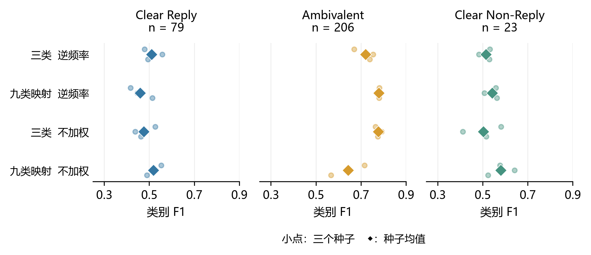

# 对话问答回避检测中的标签层级建模与跨场景迁移分析

自然语言处理课程期末研究项目。以QEvasion回答清晰度分类为原任务，以QNLI为迁移任务，分析基础模型、监督迁移、标签粒度与类别权重的作用。本仓库提供训练和补充分析代码、逐样本预测、主文图表，以及无需GPU的结果复核入口。

## 研究问题与结论

1. **基础性能与类别不均衡**：在统一划分下，TF-IDF、固定句向量与RoBERTa表现如何？Accuracy与Macro-F1可能给出不同排序，需要保留类别级指标。
2. **跨场景迁移边界**：QEvasion监督表示对QNLI是否有帮助？结果取决于适配方式；固定表示的三个源种子方向一致，整体微调对照未保留优势。
3. **标签层级与权重**：九类策略监督再映射为三类是否优于直接三分类？平均变化受权重条件影响，五项配对区间均跨0，不能声称稳定普适的提升。

| QEvasion设置 | 种子数 | 测试Macro-F1均值 ± 样本标准差 |
|---|---:|---:|
| 直接三类／逆频率加权 | 3 | 0.5814 ± 0.0199 |
| 九类监督再映射／逆频率加权 | 3 | 0.5933 ± 0.0223 |
| 直接三类／不加权 | 3 | 0.5846 ± 0.0385 |
| 九类监督再映射／不加权 | 3 | 0.5803 ± 0.0476 |

| QNLI固定CLS表示＋开发选参LR | 测试Macro-F1 | 相对原始表示 |
|---|---:|---:|
| 原始RoBERTa | 0.7553 | 参照 |
| QEvasion源seed42 | 0.7682 | +0.0129 |
| QEvasion源seed2024 | 0.7867 | +0.0314 |
| QEvasion源seed3407 | 0.7682 | +0.0129 |

排除23条细类歧义拟合记录后的六次重训未产生一致收益：九类加权测试均值0.5933→0.5907，不加权0.5803→0.5749。删除记录同时改变训练分布、步数、打乱顺序及权重，因此只作敏感性分析。



## 先核对已发布结果

需要Python 3.11。下面两条命令只用标准库，无需安装模型依赖、下载数据或使用GPU：

```bash
python scripts/verify_results.py
python -m unittest discover -s tests -v
```

核验器检查34份预测的样本顺序、Accuracy、Macro-F1、类别Precision／Recall／F1／support、混淆矩阵及概率约束，并检查发布文件SHA-256。默认只读；可用`--output reports/verification.json`另存结果。

安装基础依赖后，可以复算191个回答组、5000次重采样的五项配对区间，以及原实验协议测试：

```bash
python -m pip install -r requirements.txt
python scripts/verify_bootstrap.py
python -m unittest discover -s experiment/tests -v
```

分组bootstrap条件于既有检查点，不包含重训、选参和真实来源群体变化的不确定性。

## 目录

```text
experiment/src/        原任务清洗、基线、编码器训练、QNLI迁移与评测
experiment/run_all.py  原任务分阶段运行器
experiment/tests/      数据隔离、概率一致性与失败传播测试
scripts/               补充实验、独立指标、结果核验和输入登记
run_study.py           完整研究流程的计划／执行入口
results/predictions/   34组测试预测，保留索引、标签与概率
results/metrics/       与预测对应的完整指标
results/analysis/      四组对照、配对区间、回答组编号和歧义敏感性
results/figures/       4张主文图，PNG与SVG
results/tables/        8张主表CSV、主表与10张附录表JSON
provenance/            来源哈希、训练配置、开发选参与发布清单
docs/                  复现、代码审核与来源说明
.github/workflows/     离线结果核验、测试和代码检查
```

数据正文、预训练／训练权重、特征缓存、个人封面、课程模板和本机内部审核备份不放入上传目录。逐样本结果仅去掉问题／回答文本，原预测顺序、标签、概率及指标数值保留；导出前文件哈希记录在`results/index.json`。训练配置中的本机绝对路径转换为仓库内相对路径，转换范围在审核说明中记录。

## 完整训练与分析

完整流程需要另行取得数据和模型，并安装PyTorch、Transformers等依赖。原实验使用Python 3.11、RTX 5070 Laptop、CUDA 12.8及bf16；详细环境、数据来源和运行顺序见[复现说明](docs/REPRODUCIBILITY.md)。`requirements-lock.reference.txt`保留原实验记录的版本，包含CUDA专用torch版本；它与跨平台基础依赖说明分开。

先查看计划，此操作不联网、不训练、不写运行产物：

```bash
python run_study.py --stage all --dry-run
python experiment/run_all.py --stage all --dry-run
```

准备环境和输入后，在**独立的新工作副本**中执行：

```bash
python run_study.py --stage all
```

默认从Hugging Face官方站点获取缺失输入；可设置`HF_ENDPOINT`切换镜像。实验产物写入`experiment/outputs/revised`和被Git忽略的`补充实验`目录，发布结果保留在`results`中。原始数据随上游版本变化及不同硬件／依赖可能造成差异；只有输入哈希、配置及数据划分均匹配时，才适合与本仓库结果进行同协议比较。

## 数据和评价协议

- QEvasion清洗后的训练侧3355条按title分为拟合3138、开发217，官方测试308保留；title组不等于独立访谈来源。
- QNLI从训练侧固定抽取30000条，拟合25514、开发4486；GLUE validation的5463条作为本地最终评测，未使用官方隐藏test标签。
- 编码器句对总长512、longest_first、batch8、lr2e-5、最多5轮、开发集早停；种子42／2024／3407。
- 九类方案采用九类argmax后映射为三类，不能与先汇总粗类概率再argmax混同。测试集没有九类金标。
- 原冻结神经头及整体微调迁移控制仅seed42；固定表示LR另有三个源种子。固定表示协议同时改变头结构、优化和dropout，不能将跨协议差异归因为单一因素。

## 代码维护与审核

```bash
python -m pip install -r requirements-dev.txt
ruff check .
ruff format . --check
```

本地已完成逐样本指标复算、配对区间复算、协议测试和打包检查；远程GitHub Actions需上传后才会实际执行。审核调整见[代码审核记录](docs/CODE_REVIEW.md)，第三方数据与方法来源见[来源与使用说明](docs/SOURCES.md)。仓库未为项目自编代码附加开源许可证；第三方材料遵守各自来源条款。

## 主要参考

1. Thomas et al. “I Never Said That”: A dataset, taxonomy and baselines on response clarity classification. Findings of EMNLP 2024. [论文](https://aclanthology.org/2024.findings-emnlp.300/)
2. Wang et al. GLUE: A Multi-Task Benchmark and Analysis Platform for Natural Language Understanding. 2018. [论文](https://aclanthology.org/W18-5446/)
3. Reimers and Gurevych. Sentence-BERT. EMNLP-IJCNLP 2019. [论文](https://aclanthology.org/D19-1410/)
4. Dror et al. The Hitchhiker’s Guide to Testing Statistical Significance in Natural Language Processing. ACL 2018. [论文](https://aclanthology.org/P18-1128/)
